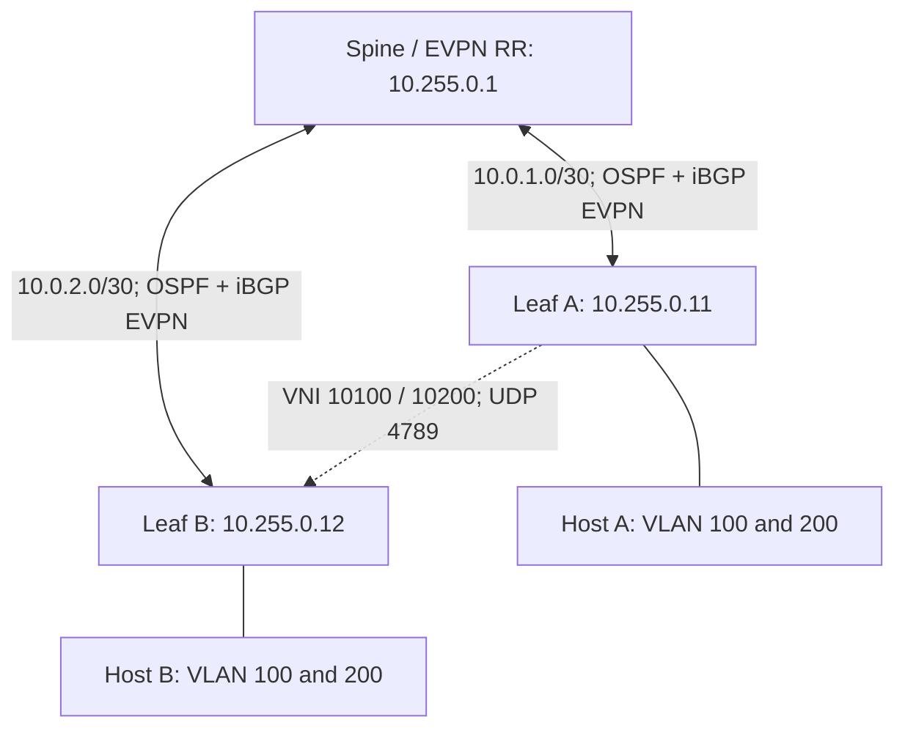

# VXLAN [Huawei & Cisco]

Practical VXLAN learning notes and lab configurations for Huawei CloudEngine VRP and Cisco Nexus NX-OS, from static Layer 2 extension to BGP EVPN, mixed-vendor operation, and fault isolation.

**Repository name:** `VXLAN-Huawei-Cisco`  
**Maintainer:** Amir Hosan Jesan / NetronixBD  
**Status:** Documentation-reviewed lab templates. No switch or emulator execution has been performed for this release.

## What is VXLAN?

VXLAN carries an Ethernet frame inside an IP/UDP packet so that a Layer 2 segment can span a routed network. A VTEP performs encapsulation and decapsulation, while a VNI identifies the overlay segment. VXLAN uses UDP destination port 4789 in these labs. It does not encrypt traffic.

The underlay delivers packets between VTEP IP addresses. The overlay carries customer Ethernet traffic. Static VXLAN explicitly lists remote VTEPs; BGP EVPN distributes overlay reachability and builds forwarding state dynamically.

বাংলায়: দুই জায়গার একই Layer 2 network-কে মাঝখানের routed IP network দিয়ে যুক্ত করা যায়। মাঝের router-গুলোকে customer VLAN বা MAC শিখতে হয় না; তারা VTEP IP অনুযায়ী packet forward করে। EVPN হলো এই overlay-এর control plane, VXLAN হলো data-plane encapsulation।

## What is included?

| Guide | Contents |
|---|---|
| [01 — Concepts](docs/01-vxlan-concepts.md) | VTEP, VNI, underlay, overlay, BUM, RD/RT and packet flow |
| [02 — Platform and topology](docs/02-platform-topology.md) | Prerequisites, address plans and Mermaid diagrams |
| [03 — Huawei basic](docs/03-huawei-basic-static.md) | Full two-leaf static VXLAN configuration |
| [04 — Cisco basic](docs/04-cisco-basic-static.md) | Full two-leaf NX-OS static VXLAN configuration |
| [05 — Huawei advanced](docs/05-huawei-advanced-evpn.md) | OSPF, iBGP EVPN, two VNIs and Huawei RR |
| [06 — Cisco advanced](docs/06-cisco-advanced-evpn.md) | OSPF, iBGP EVPN, two VNIs and Cisco RR |
| [07 — Huawei–Cisco interoperability](docs/07-huawei-cisco-interop.md) | Exact file selections for mixed-vendor labs |
| [08 — Basic troubleshooting](docs/08-basic-troubleshooting.md) | Layered checks and command comparison |
| [09 — Advanced troubleshooting](docs/09-advanced-troubleshooting.md) | Type 2/3 routes, MTU, packet capture and fault drills |
| [10 — Advanced design](docs/10-advanced-design.md) | IRB, L3VNI, multihoming and resilience design boundaries |
| [11 — Operations](docs/11-operations-validation.md) | Test matrix, saving, rollback and evidence template |
| [12 — GitHub setup](docs/12-github-setup.md) | Repo name, description, topics and upload instructions |
| [13 — References](docs/13-references.md) | Standards and official vendor documentation |

## Start here

1. Read the concepts and platform requirements.
2. Use the **static** lab first. Select one Leaf A file and one Leaf B file.
3. Configure tagged VLAN 100 on the attached hosts/access switches.
4. Verify sourced loopback reachability, host ARP and host-to-host traffic.
5. Use a separate clean topology for **EVPN**. Select two leaves and one spine/RR.
6. Test both VNIs, isolation and the fault drills.

## Lab topology

The spine forwards the VXLAN IP packets and reflects EVPN routes. It is not a VTEP in this lab. The dotted connection represents the logical overlay, not an extra physical cable.

## Choose a lab

| Lab | Nodes | Underlay | Control plane | Segments |
|---|---|---|---|---|
| Static | Two leaves | Direct routed link + /32 static routes | Flood-and-learn; static peers | VLAN 100 / VNI 10100 |
| EVPN | Two leaves + spine | OSPF area 0 | iBGP EVPN, AS 65000 | VLAN 100 and 200 / VNI 10100 and 10200 |

Do not merge the static and EVPN files on the same running topology. They use different links, routing and replication mechanisms.

## Platform scope

- **Huawei:** VXLAN-capable CloudEngine with the `bridge-domain ... evpn` configuration style and staged VRP commit workflow.
- **Cisco:** VXLAN-capable Nexus 9000 in NX-OS mode; configuration style based on NX-OS 10.x documentation.
- Catalyst IOS XE, Cisco ACI, Huawei campus/NetEngine syntax and older VRP variants are not interchangeable with these templates.
- Exact switch PID, release, license, interface naming, MTU and hardware forwarding support must be confirmed before loading.
- A successful CLI parse does not prove hardware encapsulation or interoperability.

## Browse the Markdown configuration library

All **10 device configuration templates** have been converted from `.cfg` to GitHub-friendly `.md` guides. They include the unchanged CLI, device role and addressing, prerequisites and verification commands.

**[Open Configuration Library →](configs/README.md)**

| Scenario | Cisco Nexus | Huawei CloudEngine |
|:--|:--|:--|
| Static Leaf 1 | [Cisco Leaf 1](configs/static/cisco-leaf1.md) | [Huawei Leaf 1](configs/static/huawei-leaf1.md) |
| Static Leaf 2 | [Cisco Leaf 2](configs/static/cisco-leaf2.md) | [Huawei Leaf 2](configs/static/huawei-leaf2.md) |
| EVPN Leaf 1 | [Cisco Leaf 1](configs/evpn/cisco-leaf1.md) | [Huawei Leaf 1](configs/evpn/huawei-leaf1.md) |
| EVPN Leaf 2 | [Cisco Leaf 2](configs/evpn/cisco-leaf2.md) | [Huawei Leaf 2](configs/evpn/huawei-leaf2.md) |
| EVPN Spine/RR | [Cisco Spine/RR](configs/evpn/cisco-spine-rr.md) | [Huawei Spine/RR](configs/evpn/huawei-spine-rr.md) |

> [!TIP]
> For the existing GitHub repository, extract the ZIP and use `git add -A` to stage both the added `.md` files and the deletion of old `.cfg` files.

## File layout

| Path | Purpose |
|---|---|
| `README.md` | Project introduction and navigation |
| `docs/` | Detailed Markdown guides |
| [`configs/static/`](configs/README.md) | Four GitHub-ready static leaf configuration guides |
| [`configs/evpn/`](configs/README.md) | Four EVPN leaf guides and two alternative RR guides |
| `diagrams/` | Editable Mermaid sources |
| `VALIDATION.md` | Checks performed and checks still requiring hardware |
| `CHANGELOG.md` | Release history |

## Scope and limitations

These are isolated L2 bridging labs, not a production deployment bundle. No default gateway, NAT, Internet transit, management authentication or production access-control policy is configured. Different VLANs intentionally cannot communicate. Advanced L3/HA topics are explained separately and are not presented as unverified universal commands.

No real device configuration, credentials or vendor images are included. No license is granted to redistribute vendor software. A repository content license has not been selected; add one deliberately before permitting reuse under a specific license.

See [references](docs/13-references.md) and [validation](VALIDATION.md).
