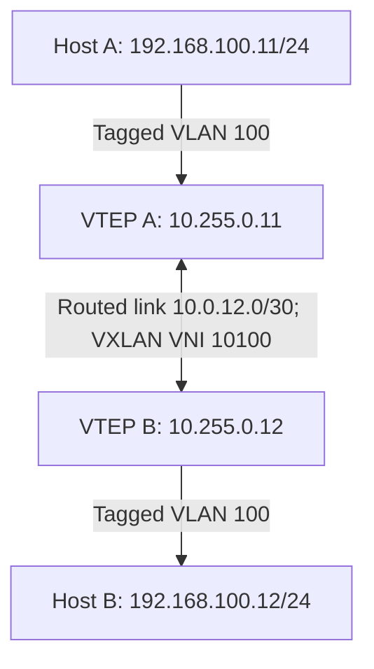
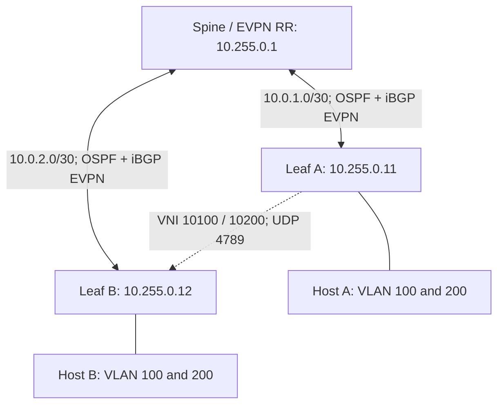

# 02 — Platform, Topology and Address Plan

[Home](../README.md)

## Compatibility gate

Record actual results before using the templates. No exact hardware/release combination has been tested for this repository.

| Requirement | Huawei | Cisco |
|---|---|---|
| Intended family | VXLAN-capable CloudEngine | VXLAN-capable Nexus 9000 |
| OS style | VRP, nested BD EVPN | NX-OS 10.x style |
| Routed uplink example | `10GE1/0/1` | `Ethernet1/1` |
| Tagged host port | `10GE1/0/2` with L2 subinterfaces | `Ethernet1/2` trunk |
| Candidate workflow | `commit`, then `save` | Commands apply immediately, then copy running to startup |
| Must verify | Feature/license, BD EVPN syntax, MTU, interface type | PID/ASIC, release, feature/license, TCAM/scale requirements |

Do not assume a generic eNSP S5700, Catalyst image, vIOS-L2 image or virtual control-plane-only appliance can forward VXLAN. Supply legally obtained images; verify both control-plane and data-plane capability. No prebuilt EVE-NG/GNS3 topology is included because image names and interfaces depend on the installed images.

## Lab A: two-leaf static VXLAN



| Role | Loopback / VTEP | Uplink address | Host interface |
|---|---|---|---|
| Leaf A / file `leaf1` | 10.255.0.11/32 | 10.0.12.1/30 | VLAN 100 tagged |
| Leaf B / file `leaf2` | 10.255.0.12/32 | 10.0.12.2/30 | VLAN 100 tagged |

A /32 static route on each leaf points to the other VTEP through the direct uplink. Connect uplink port 1 to uplink port 1. Both ends use VNI 10100.

## Lab B: OSPF + iBGP EVPN



| Node | Loopback | Link to spine | Overlay ASN |
|---|---|---|---|
| Spine/RR | 10.255.0.1/32 | Port 1: 10.0.1.1/30; port 2: 10.0.2.1/30 | 65000 |
| Leaf A | 10.255.0.11/32 | 10.0.1.2/30 | 65000 |
| Leaf B | 10.255.0.12/32 | 10.0.2.2/30 | 65000 |

OSPF area 0 carries transport links and loopbacks. Default broadcast OSPF network type is retained on both vendors. Loopback-sourced iBGP EVPN sessions connect each leaf to the RR. No IPv4-unicast BGP underlay is required. The RR preserves the leaf next hop; it does not terminate VXLAN.

| Service | Local VLAN / BD | L2VNI | RT | Host A | Host B |
|---|---|---|---|---|---|
| Service 100 | 100 | 10100 | 65000:10100 | 192.168.100.11/24 | 192.168.100.12/24 |
| Service 200 | 200 | 10200 | 65000:10200 | 192.168.200.11/24 | 192.168.200.12/24 |

Leaf A RDs: `10.255.0.11:100` and `10.255.0.11:200`. Leaf B RDs: `10.255.0.12:100` and `10.255.0.12:200`. RTs match between leaves; RDs differ.

## Transport and host prerequisites

- Physical links support the selected speed and are up.
- Effective end-to-end MTU accommodates VXLAN. Templates request 9216-byte routed uplink MTU; verify hardware frame limits and the actual OS meaning before use.
- Permit UDP 4789 between VTEPs. EVPN also needs TCP 179 between BGP loopbacks and OSPF protocol 89 on fabric links.
- Both directions have a route to the other VTEP loopback.
- No NAT exists between the lab VTEPs.
- Attached hosts/access switches send VLAN 100 tags, and VLAN 200 tags in the EVPN lab.
- Existing switching defaults or interface configuration do not conflict with routed uplinks or L2 subinterfaces.

An untagged PC must connect through an access switch that translates its access VLAN into the tagged trunk expected by this lab, or use a correctly configured VLAN subinterface on the PC.

## Linux host examples

Replace `enp1s0` with the dedicated lab NIC; do not use a management NIC. On Host A:

```bash
sudo ip link add link enp1s0 name enp1s0.100 type vlan id 100
sudo ip addr add 192.168.100.11/24 dev enp1s0.100
sudo ip link set enp1s0 up
sudo ip link set enp1s0.100 up
ping -c 5 192.168.100.12
```

Host B uses `.12` instead of `.11`. For EVPN repeat with VLAN 200 and the 192.168.200.0/24 subnet. Do not add a default route for these same-subnet tests. Existing VLAN subinterfaces should be inspected rather than recreated.
