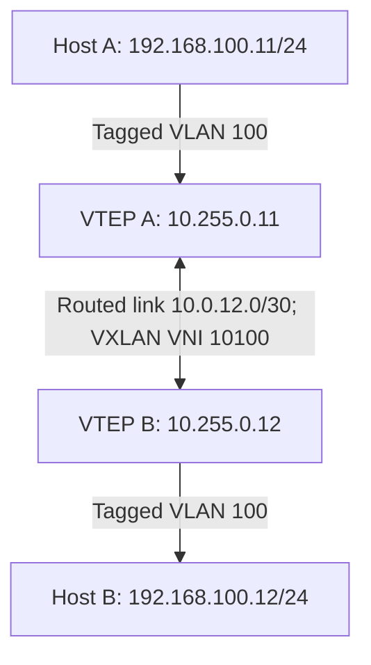

# 03 — Huawei Basic Static VXLAN

[Home](../README.md) · [Topology and prerequisites](02-platform-topology.md)

## Goal

Connect Host A and Host B in VLAN 100 across an IPv4 routed link using VNI 10100. This is a flood-and-learn lab with static ingress replication, not BGP EVPN.

Use two Huawei leaves, or choose the opposite vendor's `leaf2` template for mixed-vendor testing. Leaf A always uses VTEP 10.255.0.11 and Leaf B always uses 10.255.0.12.

## Diagram



## Before configuration

Read the platform gate first. These templates use CloudEngine nested bridge-domain syntax and a staged commit workflow. `encapsulation dot1q` identifies tagged service traffic; do not add model-specific tag rewrite commands without checking the release guide.

## Leaf A complete configuration

Source file: [configs/static/huawei-leaf1.cfg](../configs/static/huawei-leaf1.cfg)

```text
system-view
sysname HW-LEAF-1
interface LoopBack0
 ip address 10.255.0.11 255.255.255.255
 quit
interface 10GE1/0/1
 description UNDERLAY
 undo portswitch
 ip address 10.0.12.1 255.255.255.252
 mtu 9216
 undo shutdown
 quit
ip route-static 10.255.0.12 255.255.255.255 10.0.12.2
bridge-domain 100
 vxlan vni 10100
 quit
interface 10GE1/0/2
 description TAGGED-HOST-OR-ACCESS-SWITCH
 undo shutdown
 quit
interface 10GE1/0/2.100 mode l2
 encapsulation dot1q vid 100
 bridge-domain 100
 quit
interface Nve1
 source 10.255.0.11
 vni 10100 head-end peer-list 10.255.0.12
 quit
commit
return
```

## Leaf B complete configuration

Source file: [configs/static/huawei-leaf2.cfg](../configs/static/huawei-leaf2.cfg)

```text
system-view
sysname HW-LEAF-2
interface LoopBack0
 ip address 10.255.0.12 255.255.255.255
 quit
interface 10GE1/0/1
 description UNDERLAY
 undo portswitch
 ip address 10.0.12.2 255.255.255.252
 mtu 9216
 undo shutdown
 quit
ip route-static 10.255.0.11 255.255.255.255 10.0.12.1
bridge-domain 100
 vxlan vni 10100
 quit
interface 10GE1/0/2
 description TAGGED-HOST-OR-ACCESS-SWITCH
 undo shutdown
 quit
interface 10GE1/0/2.100 mode l2
 encapsulation dot1q vid 100
 bridge-domain 100
 quit
interface Nve1
 source 10.255.0.12
 vni 10100 head-end peer-list 10.255.0.11
 quit
commit
return
```

## What the configuration does

1. Sets a loopback as the stable VTEP source.
2. Makes port 1 a routed underlay interface with /30 addressing.
3. Installs a host route to the remote VTEP loopback.
4. Maps the local bridge domain 100 to VNI 10100.
5. Maps tagged host traffic into that service.
6. Configures the remote VTEP as the static BUM replication destination.

## Verification

```text
display ip routing-table 10.255.0.12
ping -a 10.255.0.11 10.255.0.12
display vxlan vni
display vxlan tunnel
display bridge-domain 100
display mac-address bridge-domain 100
```

Commands above are from Leaf A. Reverse source/destination when checking Leaf B. Generate traffic from the hosts, then expect local and remote host MAC entries in service 100. Confirm both host ping directions and ARP resolution. There are no BGP routes or Type 3 routes to inspect in this lab.

Tunnel/VNI state is necessary evidence, not an end-to-end reachability test. Save configuration only after the validation matrix passes.
