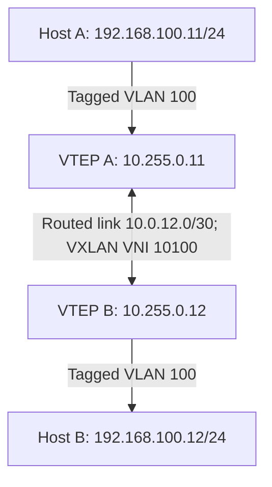

# 04 — Cisco Basic Static VXLAN

[Home](../README.md) · [Topology and prerequisites](02-platform-topology.md)

## Goal

Connect Host A and Host B in VLAN 100 across an IPv4 routed link using VNI 10100. This is a flood-and-learn lab with static ingress replication, not BGP EVPN.

Use two Cisco leaves, or choose the opposite vendor's `leaf2` template for mixed-vendor testing. Leaf A always uses VTEP 10.255.0.11 and Leaf B always uses 10.255.0.12.

## Diagram



## Before configuration

Read the platform gate first. These templates use Nexus NX-OS, not Catalyst IOS XE. Some older ASICs/releases need additional resource or routing-template preparation, possibly including a reload; do not apply such changes without checking the platform guide.

## Leaf A complete configuration

Source file: [configs/static/cisco-leaf1.cfg](../configs/static/cisco-leaf1.cfg)

```text
configure terminal
hostname NX-LEAF-1
feature nv overlay
feature vn-segment-vlan-based
interface loopback0
 ip address 10.255.0.11/32
 no shutdown
interface Ethernet1/1
 description UNDERLAY
 no switchport
 ip address 10.0.12.1/30
 mtu 9216
 no shutdown
ip route 10.255.0.12/32 10.0.12.2
vlan 100
 name TENANT-100
 vn-segment 10100
interface Ethernet1/2
 description TAGGED-HOST-OR-ACCESS-SWITCH
 switchport
 switchport mode trunk
 switchport trunk allowed vlan 100
 no shutdown
interface nve1
 no shutdown
 source-interface loopback0
 member vni 10100
  ingress-replication protocol static
   peer-ip 10.255.0.12
end
```

## Leaf B complete configuration

Source file: [configs/static/cisco-leaf2.cfg](../configs/static/cisco-leaf2.cfg)

```text
configure terminal
hostname NX-LEAF-2
feature nv overlay
feature vn-segment-vlan-based
interface loopback0
 ip address 10.255.0.12/32
 no shutdown
interface Ethernet1/1
 description UNDERLAY
 no switchport
 ip address 10.0.12.2/30
 mtu 9216
 no shutdown
ip route 10.255.0.11/32 10.0.12.1
vlan 100
 name TENANT-100
 vn-segment 10100
interface Ethernet1/2
 description TAGGED-HOST-OR-ACCESS-SWITCH
 switchport
 switchport mode trunk
 switchport trunk allowed vlan 100
 no shutdown
interface nve1
 no shutdown
 source-interface loopback0
 member vni 10100
  ingress-replication protocol static
   peer-ip 10.255.0.11
end
```

## What the configuration does

1. Sets a loopback as the stable VTEP source.
2. Makes port 1 a routed underlay interface with /30 addressing.
3. Installs a host route to the remote VTEP loopback.
4. Maps the local VLAN 100 to VNI 10100.
5. Maps tagged host traffic into that service.
6. Configures the remote VTEP as the static BUM replication destination.

## Verification

```text
show ip route 10.255.0.12
ping 10.255.0.12 source 10.255.0.11
show nve interface nve1 detail
show nve peers
show nve vni
show vlan brief
show mac address-table vlan 100
```

Commands above are from Leaf A. Reverse source/destination when checking Leaf B. Generate traffic from the hosts, then expect local and remote host MAC entries in service 100. Confirm both host ping directions and ARP resolution. There are no BGP routes or Type 3 routes to inspect in this lab.

Tunnel/VNI state is necessary evidence, not an end-to-end reachability test. Save configuration only after the validation matrix passes.
