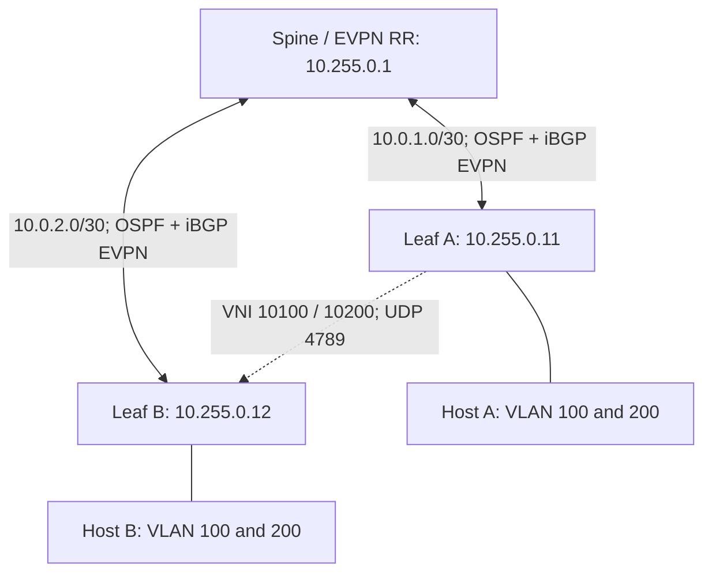

# 05 — Huawei Advanced BGP EVPN-VXLAN

[Home](../README.md) · [Interoperability](07-huawei-cisco-interop.md)

## Lab objective

Use OSPF area 0 for underlay reachability and iBGP EVPN in AS 65000 for overlay signaling. Two L2 services use explicit route targets and ingress replication. A separate spine reflects routes and forwards outer IP packets.

This is an advanced L2 control-plane lab. It intentionally does not configure an L3VNI, distributed gateway, vPC, M-LAG or ESI multihoming.

## Topology



Start from a clean topology or a reviewed baseline. Do not paste these commands over the static lab: its physical connections, static routes and replication state differ.

## Spine / route reflector

Use this Huawei RR or the other vendor's RR, never both at the same time. No NVE, customer VLAN or VNI is required on the RR in this design.

Source: [configs/evpn/huawei-spine-rr.md](../configs/evpn/huawei-spine-rr.md)

```text
system-view
sysname HW-SPINE-RR
interface LoopBack0
 ip address 10.255.0.1 255.255.255.255
 quit
interface 10GE1/0/1
 undo portswitch
 ip address 10.0.1.1 255.255.255.252
 mtu 9216
 undo shutdown
 quit
interface 10GE1/0/2
 undo portswitch
 ip address 10.0.2.1 255.255.255.252
 mtu 9216
 undo shutdown
 quit
ospf 1 router-id 10.255.0.1
 area 0.0.0.0
  network 10.0.1.0 0.0.0.3
  network 10.0.2.0 0.0.0.3
  network 10.255.0.1 0.0.0.0
  quit
 quit
evpn-overlay enable
bgp 65000
 router-id 10.255.0.1
 peer 10.255.0.11 as-number 65000
 peer 10.255.0.11 connect-interface LoopBack0
 peer 10.255.0.12 as-number 65000
 peer 10.255.0.12 connect-interface LoopBack0
 ipv4-family unicast
  undo peer 10.255.0.11 enable
  undo peer 10.255.0.12 enable
  quit
 l2vpn-family evpn
  undo policy vpn-target
  peer 10.255.0.11 enable
  peer 10.255.0.11 reflect-client
  peer 10.255.0.12 enable
  peer 10.255.0.12 reflect-client
  quit
 quit
commit
return
```

## Leaf A

Source: [configs/evpn/huawei-leaf1.md](../configs/evpn/huawei-leaf1.md)

```text
system-view
sysname HW-LEAF-1
interface LoopBack0
 ip address 10.255.0.11 255.255.255.255
 quit
interface 10GE1/0/1
 description UNDERLAY
 undo portswitch
 ip address 10.0.1.2 255.255.255.252
 mtu 9216
 undo shutdown
 quit
ospf 1 router-id 10.255.0.11
 area 0.0.0.0
  network 10.0.1.0 0.0.0.3
  network 10.255.0.11 0.0.0.0
  quit
 quit
evpn-overlay enable
bgp 65000
 router-id 10.255.0.11
 peer 10.255.0.1 as-number 65000
 peer 10.255.0.1 connect-interface LoopBack0
 ipv4-family unicast
  undo peer 10.255.0.1 enable
  quit
 l2vpn-family evpn
  peer 10.255.0.1 enable
  quit
 quit
bridge-domain 100
 vxlan vni 10100
 evpn
  route-distinguisher 10.255.0.11:100
  vpn-target 65000:10100 export-extcommunity
  vpn-target 65000:10100 import-extcommunity
  quit
 quit
bridge-domain 200
 vxlan vni 10200
 evpn
  route-distinguisher 10.255.0.11:200
  vpn-target 65000:10200 export-extcommunity
  vpn-target 65000:10200 import-extcommunity
  quit
 quit
interface 10GE1/0/2
 description TAGGED-HOST-OR-ACCESS-SWITCH
 undo shutdown
 quit
interface 10GE1/0/2.100 mode l2
 encapsulation dot1q vid 100
 bridge-domain 100
 quit
interface 10GE1/0/2.200 mode l2
 encapsulation dot1q vid 200
 bridge-domain 200
 quit
interface Nve1
 source 10.255.0.11
 vni 10100 head-end peer-list protocol bgp
 vni 10200 head-end peer-list protocol bgp
 quit
commit
return
```

## Leaf B

Source: [configs/evpn/huawei-leaf2.md](../configs/evpn/huawei-leaf2.md)

```text
system-view
sysname HW-LEAF-2
interface LoopBack0
 ip address 10.255.0.12 255.255.255.255
 quit
interface 10GE1/0/1
 description UNDERLAY
 undo portswitch
 ip address 10.0.2.2 255.255.255.252
 mtu 9216
 undo shutdown
 quit
ospf 1 router-id 10.255.0.12
 area 0.0.0.0
  network 10.0.2.0 0.0.0.3
  network 10.255.0.12 0.0.0.0
  quit
 quit
evpn-overlay enable
bgp 65000
 router-id 10.255.0.12
 peer 10.255.0.1 as-number 65000
 peer 10.255.0.1 connect-interface LoopBack0
 ipv4-family unicast
  undo peer 10.255.0.1 enable
  quit
 l2vpn-family evpn
  peer 10.255.0.1 enable
  quit
 quit
bridge-domain 100
 vxlan vni 10100
 evpn
  route-distinguisher 10.255.0.12:100
  vpn-target 65000:10100 export-extcommunity
  vpn-target 65000:10100 import-extcommunity
  quit
 quit
bridge-domain 200
 vxlan vni 10200
 evpn
  route-distinguisher 10.255.0.12:200
  vpn-target 65000:10200 export-extcommunity
  vpn-target 65000:10200 import-extcommunity
  quit
 quit
interface 10GE1/0/2
 description TAGGED-HOST-OR-ACCESS-SWITCH
 undo shutdown
 quit
interface 10GE1/0/2.100 mode l2
 encapsulation dot1q vid 100
 bridge-domain 100
 quit
interface 10GE1/0/2.200 mode l2
 encapsulation dot1q vid 200
 bridge-domain 200
 quit
interface Nve1
 source 10.255.0.12
 vni 10100 head-end peer-list protocol bgp
 vni 10200 head-end peer-list protocol bgp
 quit
commit
return
```

## Control-plane reasoning

- The underlay makes all three loopbacks mutually reachable.
- The leaves peer only with 10.255.0.1, using loopback source addresses.
- The RR reflects routes between its clients without becoming their VXLAN endpoint.
- Explicit RT 65000:10100 identifies service 100 and 65000:10200 identifies service 200.
- Each leaf's RD is unique. Do not copy Leaf A RDs to Leaf B.
- Type 3 membership supplies the remote replication destination.
- Type 2 routes identify host MAC reachability after local traffic is learned. A Type 2 MAC-only route is not automatically a fault.

The Huawei RR disables local VPN-target filtering because it has no local service memberships. The Cisco RR template retains route-target routes. These are RR roles; do not remove all import controls on tenant leaves as a troubleshooting shortcut.

## Bring-up order

1. Configure the spine and underlay ports/loopbacks on both leaves.
2. Verify two OSPF adjacencies on the spine and one on each leaf.
3. Verify each leaf can ping the other leaf's loopback using its own loopback source.
4. Verify EVPN BGP sessions are Established.
5. Confirm both VNIs and matching RTs.
6. Connect tagged hosts and generate ARP/ICMP.
7. Verify Type 2 and Type 3 routes, installed MAC forwarding and traffic in both services.
8. Confirm service 100 cannot communicate with service 200 because no L3 gateway is configured.

## Verification

```text
display ospf peer
display ip routing-table
ping -a 10.255.0.11 10.255.0.12
display bgp evpn peer
display bgp evpn all routing-table
display bgp evpn all routing-table mac-route
display vxlan vni
display vxlan tunnel
display mac-address bridge-domain 100
display mac-address bridge-domain 200
```

Use the source address appropriate for the device you are checking. Command variants can differ by release; inspect CLI help if a detailed form is unavailable. Do not mistake these expected outcomes for captured results from actual equipment.
