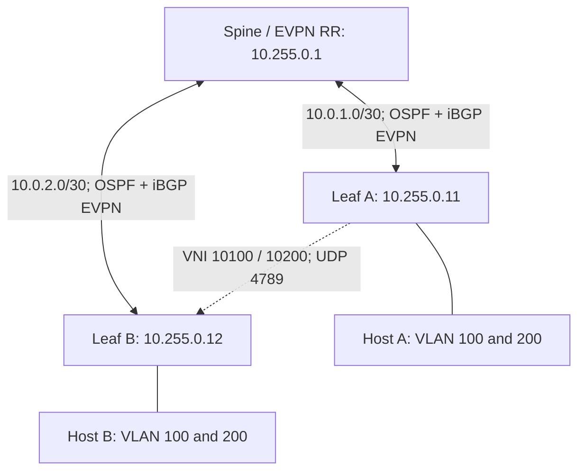

# 06 — Cisco Advanced BGP EVPN-VXLAN

[Home](../README.md) · [Interoperability](07-huawei-cisco-interop.md)

## Lab objective

Use OSPF area 0 for underlay reachability and iBGP EVPN in AS 65000 for overlay signaling. Two L2 services use explicit route targets and ingress replication. A separate spine reflects routes and forwards outer IP packets.

This is an advanced L2 control-plane lab. It intentionally does not configure an L3VNI, distributed gateway, vPC, M-LAG or ESI multihoming.

## Topology



Start from a clean topology or a reviewed baseline. Do not paste these commands over the static lab: its physical connections, static routes and replication state differ.

## Spine / route reflector

Use this Cisco RR or the other vendor's RR, never both at the same time. No NVE, customer VLAN or VNI is required on the RR in this design.

Source: [configs/evpn/cisco-spine-rr.cfg](../configs/evpn/cisco-spine-rr.cfg)

```text
configure terminal
hostname NX-SPINE-RR
feature ospf
feature bgp
nv overlay evpn
interface loopback0
 ip address 10.255.0.1/32
 ip router ospf UNDERLAY area 0.0.0.0
interface Ethernet1/1
 description TO-LEAF-A
 no switchport
 ip address 10.0.1.1/30
 mtu 9216
 ip router ospf UNDERLAY area 0.0.0.0
 no shutdown
interface Ethernet1/2
 description TO-LEAF-B
 no switchport
 ip address 10.0.2.1/30
 mtu 9216
 ip router ospf UNDERLAY area 0.0.0.0
 no shutdown
router ospf UNDERLAY
 router-id 10.255.0.1
router bgp 65000
 router-id 10.255.0.1
 address-family l2vpn evpn
  retain route-target all
 neighbor 10.255.0.11
  remote-as 65000
  update-source loopback0
  address-family l2vpn evpn
   send-community both
   route-reflector-client
 neighbor 10.255.0.12
  remote-as 65000
  update-source loopback0
  address-family l2vpn evpn
   send-community both
   route-reflector-client
end
```

## Leaf A

Source: [configs/evpn/cisco-leaf1.cfg](../configs/evpn/cisco-leaf1.cfg)

```text
configure terminal
hostname NX-LEAF-1
feature nv overlay
feature vn-segment-vlan-based
feature ospf
feature bgp
nv overlay evpn
interface loopback0
 ip address 10.255.0.11/32
 no shutdown
interface Ethernet1/1
 description UNDERLAY
 no switchport
 ip address 10.0.1.2/30
 mtu 9216
 no shutdown
 ip router ospf UNDERLAY area 0.0.0.0
interface loopback0
 ip router ospf UNDERLAY area 0.0.0.0
router ospf UNDERLAY
 router-id 10.255.0.11
router bgp 65000
 router-id 10.255.0.11
 neighbor 10.255.0.1
  remote-as 65000
  update-source loopback0
  address-family l2vpn evpn
   send-community both
vlan 100
 name TENANT-100
 vn-segment 10100
vlan 200
 name TENANT-200
 vn-segment 10200
interface Ethernet1/2
 description TAGGED-HOST-OR-ACCESS-SWITCH
 switchport
 switchport mode trunk
 switchport trunk allowed vlan 100,200
 no shutdown
interface nve1
 no shutdown
 source-interface loopback0
 host-reachability protocol bgp
 member vni 10100
  ingress-replication protocol bgp
 member vni 10200
  ingress-replication protocol bgp
evpn
 vni 10100 l2
  rd 10.255.0.11:100
  route-target import 65000:10100
  route-target export 65000:10100
 vni 10200 l2
  rd 10.255.0.11:200
  route-target import 65000:10200
  route-target export 65000:10200
end
```

## Leaf B

Source: [configs/evpn/cisco-leaf2.cfg](../configs/evpn/cisco-leaf2.cfg)

```text
configure terminal
hostname NX-LEAF-2
feature nv overlay
feature vn-segment-vlan-based
feature ospf
feature bgp
nv overlay evpn
interface loopback0
 ip address 10.255.0.12/32
 no shutdown
interface Ethernet1/1
 description UNDERLAY
 no switchport
 ip address 10.0.2.2/30
 mtu 9216
 no shutdown
 ip router ospf UNDERLAY area 0.0.0.0
interface loopback0
 ip router ospf UNDERLAY area 0.0.0.0
router ospf UNDERLAY
 router-id 10.255.0.12
router bgp 65000
 router-id 10.255.0.12
 neighbor 10.255.0.1
  remote-as 65000
  update-source loopback0
  address-family l2vpn evpn
   send-community both
vlan 100
 name TENANT-100
 vn-segment 10100
vlan 200
 name TENANT-200
 vn-segment 10200
interface Ethernet1/2
 description TAGGED-HOST-OR-ACCESS-SWITCH
 switchport
 switchport mode trunk
 switchport trunk allowed vlan 100,200
 no shutdown
interface nve1
 no shutdown
 source-interface loopback0
 host-reachability protocol bgp
 member vni 10100
  ingress-replication protocol bgp
 member vni 10200
  ingress-replication protocol bgp
evpn
 vni 10100 l2
  rd 10.255.0.12:100
  route-target import 65000:10100
  route-target export 65000:10100
 vni 10200 l2
  rd 10.255.0.12:200
  route-target import 65000:10200
  route-target export 65000:10200
end
```

## Control-plane reasoning

- The underlay makes all three loopbacks mutually reachable.
- The leaves peer only with 10.255.0.1, using loopback source addresses.
- The RR reflects routes between its clients without becoming their VXLAN endpoint.
- Explicit RT 65000:10100 identifies service 100 and 65000:10200 identifies service 200.
- Each leaf's RD is unique. Do not copy Leaf A RDs to Leaf B.
- Type 3 membership supplies the remote replication destination.
- Type 2 routes identify host MAC reachability after local traffic is learned. A Type 2 MAC-only route is not automatically a fault.

The Huawei RR disables local VPN-target filtering because it has no local service memberships. The Cisco RR template retains route-target routes. These are RR roles; do not remove all import controls on tenant leaves as a troubleshooting shortcut.

## Bring-up order

1. Configure the spine and underlay ports/loopbacks on both leaves.
2. Verify two OSPF adjacencies on the spine and one on each leaf.
3. Verify each leaf can ping the other leaf's loopback using its own loopback source.
4. Verify EVPN BGP sessions are Established.
5. Confirm both VNIs and matching RTs.
6. Connect tagged hosts and generate ARP/ICMP.
7. Verify Type 2 and Type 3 routes, installed MAC forwarding and traffic in both services.
8. Confirm service 100 cannot communicate with service 200 because no L3 gateway is configured.

## Verification

```text
show ip ospf neighbors
show ip route
ping 10.255.0.12 source 10.255.0.11
show bgp l2vpn evpn summary
show bgp l2vpn evpn
show bgp l2vpn evpn route-type 2
show bgp l2vpn evpn route-type 3
show nve peers
show nve vni
show l2route evpn mac all
show mac address-table vlan 100
show mac address-table vlan 200
```

Use the source address appropriate for the device you are checking. Command variants can differ by release; inspect CLI help if a detailed form is unavailable. Do not mistake these expected outcomes for captured results from actual equipment.
