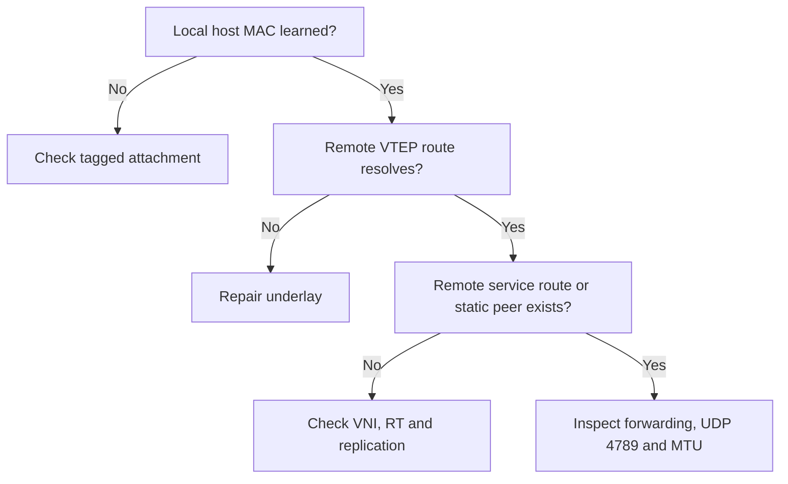

# 09 — Advanced Troubleshooting and Fault Drills

[Home](../README.md)

## Trace one failed flow

Record source/destination IP, source/destination MAC, VLAN, VNI, local/remote VTEP and time. Follow that exact service through local attachment, control plane, installed forwarding and the wire.



## 1. EVPN Established but traffic fails

A BGP session proves control-plane transport only. On Cisco examine Type 2/3 routes and `show l2route evpn mac all`; on Huawei inspect the EVPN routing table and BD MAC entries. Confirm the remote leaf's VTEP is the next hop, not the RR loopback.

Distinguish four stages: locally originated, advertised, received, imported/installed. A route visible at the RR but absent on the other leaf suggests reflection, filtering or RT processing. A received route not installed suggests import mismatch, unresolved next hop, duplicate state or hardware limits.

## 2. Missing BUM membership

Check Type 3/IMET for the correct service and its ingress-replication destination. Without the flood path, initial ARP can fail even when an old known-unicast entry still works. In static mode check both explicit peer lists instead; Type 3 does not exist there.

Do not copy a static replication list into the EVPN service as an unexplained workaround. Diagnose one control mechanism at a time.

## 3. MTU verification

First test the outer loopback path with increasing sizes and DF using the device's supported ping syntax. Next test the actual inner host flow. Linux host example:

```bash
ping -I enp1s0.100 -M do -s 1472 -c 5 192.168.100.12
```

1472 ICMP payload + 8 ICMP + 20 IPv4 produces a 1500-byte inner IP packet. Encapsulated transport needs additional space. Repeat both directions. If it fails, reduce size to find the boundary and inspect the exact link where drops begin. Jumbo support on the leaves alone is insufficient if a middle hop is smaller.

## 4. Packet capture

Use SPAN/port mirroring to an external analyzer or a supported hardware capture facility. Ordinary CPU captures often miss ASIC-forwarded traffic. Cisco ethanalyzer and Huawei control-plane packet tools must not be assumed to capture all transit VXLAN packets.

Useful Wireshark display filters:

```text
udp.port == 4789
vxlan.vni == 10100
vxlan.vni == 10200
bgp
arp
icmp
```

Use `tcpdump -nn -r capture.pcap 'udp port 4789'` for offline BPF filtering. In the decoded packet, compare outer VTEP addresses, VNI, inner MAC addresses, expected inner tag behavior, UDP destination and length.

| Observation | Interpretation to investigate |
|---|---|
| No VXLAN exits Leaf A | Access classification, missing remote MAC/flood list or local forwarding issue |
| VXLAN exits A, absent at B uplink | Underlay routing, ACL, MTU or wrong capture point |
| VXLAN reaches B, no host egress | VNI mapping, inner service/tag handling, destination MAC or hardware decapsulation |
| Host reply exists, no return VXLAN | Reverse forwarding/replication or policy |

## 5. MAC mobility and duplicates

The lab is single-homed. Repeated MAC moves can mean an unintended loop, duplicated VM MAC or a second attachment. Inspect the learned location and move timing before changing duplicate-detection thresholds. Do not connect two independent leaves with a shared customer L2 path without a reviewed multihoming design.

## 6. RR session loss is not link-loss convergence

Stopping only the RR's EVPN process can leave a working underlay. Route withdrawals, graceful restart and existing hardware state determine observed traffic behavior. Record actual loss and route aging; do not assume an instantaneous outage or hitless operation.

Physically disconnecting the only spine also removes the only transport path, so it is a different test. This lab has one spine and intentionally has no fabric path redundancy.

## Fault drills: lab only

| Inject one fault | Expected evidence | Recovery |
|---|---|---|
| Change VLAN 100 RT on one leaf | BGP remains up; service import/membership fails | Restore matching RT |
| Remove remote /32 in static lab | Sourced VTEP ping fails | Restore original route |
| Remove VLAN 200 from Cisco host trunk | VLAN 100 works; local VLAN 200 host learning fails | Restore allowed VLAN list |
| Block UDP 4789 in controlled lab path | BGP can stay up; overlay data fails | Remove the specific test ACL |
| Reduce one transport MTU | Size-dependent loss | Restore tested MTU |

Take a baseline before each drill, change one thing, collect evidence and restore it before the next drill. Broad clear/reset/debug commands are deliberately excluded.

## Escalation bundle

Include model, OS, license, topology, affected service, exact timestamps/timezone, recent changes, relevant interface counters, sourced VTEP pings, OSPF/BGP state, EVPN routes with RT/next-hop, MAC tables and short packet captures. Redact credentials and unrelated customer data.
